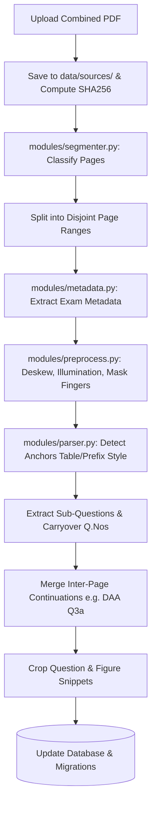

# Comprehensive Implementation Plan: Exam Paper Ingestion & Intelligence Overhaul

## 1. Executive Summary & Existing Codebase Findings

### 1.1 Existing Architecture
* **Frontend**: Single-file Streamlit application (`app.py`, ~900 lines) managing views for Predictions, Quiz, Diagnostics, Mock Generator, Back-testing, and Admin Portal.
* **Database**: SQLite (`data/exam_predictor.db`) with 10 core tables (`subjects`, `papers`, `questions`, `diagram_groups`, `tags`, `question_tags`, `mcq_bank`, `student_attempts`, `student_responses`, `audit_log`).
* **Ingestion**: Currently processes a single PDF file at a time, treating it as a single monolithic paper. It assumes `Q.` prefixes and has no capability to detect multiple combined papers in one upload or split table-styled question papers.
* **OCR & Extraction**: Relies on `RapidOCR` without image preprocessing (illumination correction, skin/thumb masking, deskewing). Fails on phone camera scans or multi-column table layouts where question numbers (`1`, `2`, `3`) sit in a narrow left column separated from sub-letters (`a`, `b`) and prompt text.
* **Security**: Currently offers a dev passcode fallback in plaintext without enforcing Google OIDC verification or per-action server authorization guards.

### 1.2 Fixture Analysis
1. **Math Fixture (`paper_sub3_2025_midterm_0105e9c3.pdf`)**:
   * 4 pages, containing **TWO distinct exam papers**:
     - **Paper 1 (Pages 1–2)**: Mid Semester Test, Date: 19/09/2024, Time: 11:15 AM to 12:45 PM (90 mins), Max Marks: 40, Course Code: `R5MA2007T`, Course Name: Mathematics for Computer Engineers, Sem-III, SY B.Tech (CE/IT). Questions Q.1 to Q.4 with sum = 40 (Q1=10, Q2=10, Q3=10, Q4=10).
     - **Paper 2 (Pages 3–4)**: Make-up Mid Semester Test (`is_makeup=1`), Date: 04/11/2024, Time: 03:00 PM to 04:30 PM (90 mins), Max Marks: 40, Course Code: `R5MA2007T`, Course Name: Mathematics for Computer Engineers, Sem-III, SY B.Tech (CE/IT). Questions Q.1 to Q.4 with sum = 40 (Q1=10, Q2=10, Q3=10, Q4=10).
2. **DAA Fixture (`paper_sub3_2025_midterm_9707d76d.pdf`)**:
   * 2 pages, single paper captured via mobile camera.
   * Format: **Table layout** with columns `Q.Nos` | `Questions` | `Marks`.
   * Metadata: VJTI, Mid Semester Examination (MSE) Sep 2024 -> `midterm`, Date: 24/09/24, Time: 11:15 AM to 12:45 PM (90 mins), Sem-III S.Y. B.Tech (Information Technology), Course Code: `R5IT2002T`, Course Name: Design and Analysis of Algorithms, Max Marks: 40.
   * Multi-page Question Continuation: Question 3a text appears at the bottom of Page 1; its associated directed graph is placed at the top of Page 2 before question 3b begins!
   * Non-content artifacts: Finger/skin contours along the left edge, repeating watermark ("DAKSH GOHIL").

### 1.3 Python & CPython 3.14 Environment Verification
* Python runtime: **CPython 3.14.6 (64-bit AMD64 Windows)**.
* OpenCV: `opencv-python` version 5.0.0.93 (using `cp37-abi3` wheel) is installed and active in `.venv`.
* Preprocessing operations (CLAHE, unsharp masking, deskew, morphological filtering, illumination compensation, and skin color masking in HSV) will leverage `cv2`, `numpy`, and `Pillow`.

---

## 2. Step-by-Step Architectural Plan

### Phase A: Combined PDF Upload, Auto-Segregation & Metadata (Part A)
1. **Database Additive Migrations (`modules/database.py`)**:
   * Guarded by `PRAGMA table_info(...)`.
   * Create `source_files` table (`id`, `sha256` UNIQUE, `filename`, `path`, `page_count`, `uploaded_at`).
   * Add additive columns to `papers`: `source_file_id`, `page_start`, `page_end`, `course_code`, `course_name_raw`, `exam_name_raw`, `exam_date`, `program`, `branch`, `study_year`, `duration_minutes`, `max_marks`, `is_makeup`, `quality_score`, `metadata_confidence`, `status`.
   * Add additive columns to `questions`: `parent_question_number`, `part_label`, `co_tag`, `page_no`, `bbox_json`, `is_continuation`, `figure_path`, `figure_phash`.
   * Add additive column to `mcq_bank`: `status` (`draft` / `verified`, default `'draft'`).
2. **Page Segmentation Engine (`modules/segmenter.py`)**:
   * Render at 300 DPI.
   * Extract words & lines (native PyMuPDF text if available, otherwise RapidOCR).
   * Feature classifier: `FIRST_PAGE` (Header table with Examination, Program, Course, Instructions), `CONTINUATION`, `BLANK`, `OTHER`.
   * Detect paper start & termination boundaries ("END OF PAPER", "All the Best", row of asterisks).
   * Handle multi-paper splitting (Math fixture: splits into Pages 1-2 and Pages 3-4).
   * Emit individual paper PDFs to `data/papers/` with deterministic hash: `sha256(source_sha256 + ":" + start + "-" + end)`.
3. **Metadata Extraction Engine (`modules/metadata.py`)**:
   * Regex & tabular parsers for course code (`R5MA2007T`, `R5IT2002T`), course name, date (`dd/mm/yy`, `dd/mm/yyyy`, `Sep 2024`), exam name/type (`Mid Semester Examination`, `MSE`, `Make-up`), semester (`Sem-III` -> 3), program/branch (`CE/IT`, `Information Technology`), duration (`90 minutes`, `1.30 HRS` -> 90), max marks (`40`).
   * Tolerant of OCR noise (`Sem-Ill` -> 3, `O/0`, `I/1/l`).
4. **Subject Matching & Auto-Accept Flow (`modules/database.py`, `app.py`)**:
   * Match subject by course code first, then fuzzy match name ($\ge 90\%$). Propose upgrading placeholder codes (e.g. "1" or "2") to real codes upon admin confirmation.
   * Auto-accept when confidence $\ge 0.85$ and marks sum equals max marks; otherwise mark `needs_review`.
   * Provide UI in Admin Ingest tab for review, manual split/merge, and confirmation.

### Phase B: Extraction Overhaul & Robust Preprocessing (Part B)
1. **Image Preprocessing (`modules/preprocess.py`)**:
   * Deskew using Radon transform / Hough lines / minAreaRect on ink pixels.
   * Shadow & illumination removal: compute large-kernel background filter (`cv2.morphologyEx` or Gaussian blur) and normalize (`img / background`).
   * Edge/finger detection & masking: HSV color thresholding for skin tones near margins (`H: 0-25, S: 30-200, V: 60-255`) combined with convex hull/contour masks.
   * Contrast enhancement via CLAHE, light unsharp mask.
   * Quality score: calculate Laplacian variance, skew angle, OCR confidence.
2. **Anchor Detection (Table vs. Prefix Voting)**:
   * **Prefix Style**: `Q.1`, `Q.2`, `Q1`, `Question 1`.
   * **Table Style**: Detect column positions via horizontal X-clustering (`Q.Nos` column on the left, `Marks` on the right).
   * In table style, detect bare numbers (`1`, `2`, `3`) and sub-letters (`a`, `b`, `c`). When a sub-letter appears without a number, carry forward the previous question number (`1` + `b` -> `1b`).
3. **Inter-Page Question Continuation (DAA Q3a Graph)**:
   * Content appearing above the first question anchor on a continuation page is recognized as belonging to the pending question of the preceding page.
   * Text is appended; visual crops are stacked vertically to ensure figures are never dropped.
4. **Marks & CO Parsing**:
   * Parse `[CO1] [5]`, `(CO2] [8]`, `[CO2|[7]`, `(5) CO5`, `[s]` -> 5.
   * Store `co_tag` and `marks` in dedicated columns.
   * Validate that the sum of question marks equals the paper's `max_marks`.
5. **Figure Extraction**:
   * Detect large connected components and contour ink regions that do not overlap with OCR text boxes.
   * Save distinct figure crops to `assets/diagrams/figures/` and compute `figure_phash` only on the figure itself.
6. **Sub-Question Storage (`SPLIT_SUBQUESTIONS = True`)**:
   * Store individual sub-questions (`1a`, `1b`, `2a`, `2b`, `3a`, etc.) with `parent_question_number = '1'`, `part_label = 'a'`, `marks = 5.0`, `co_tag = 'CO1'`.
   * Update downstream modules (`scoring.py`, `quiz_engine.py`, `mock_generator.py`, `backtester.py`) to seamlessly operate on sub-questions or group by parent.
7. **Ingestion Parallelism & Resiliency**:
   * Worker pool capped at 2 workers with isolated `RapidOCR` instances.
   * Per-page timeout and exception catching. Clean up orphaned database records and disk files on catastrophic failure.
   * Save debug diagnostic overlays under `data/debug/<paper_id>/`.

### Phase C: Data Hygiene & MCQs (Part C)
1. Ingest pipeline stops generating dummy draft MCQs with hardcoded answer 'A'.
2. `mcq_bank.status` field (`draft` / `verified`). `quiz_engine.py` queries only `status = 'verified'` questions.
3. Database maintenance action to delete orphan MCQs and unreferenced diagram groups.
4. Enforce `PRAGMA foreign_keys = ON;` on all database connections.

### Phase D: Security & Authentication (Part D)
1. Integrate Streamlit Google OIDC (`st.login`), requiring `st.user.email_verified == True` and matching `diyanshah2301@gmail.com`.
2. Remove hardcoded `"admin123"` passcode. Allow local dev passcode only if `os.environ.get("DEV_MODE") == "1"`.
3. Check authorization server-side at the entrypoint of all mutating functions.
4. Clean `.gitignore` and untrack `data/`, `assets/`, `*.db`.

### Phase E: Earlier Bug Fixes (Part E)
1. Import `get_db_connection` in `app.py`.
2. Remedial quiz reuses existing stored MCQs.
3. Fix active tag button glow styling using key-based CSS selectors (`.st-key-<key> button`).
4. Synchronize `st.session_state.nav_selection`.

### Phase F: Test Suite (`tests/test_pipeline.py`)
1. Test DAA fixture (2 pages): exactly 1 paper, VJTI, midterm, 2024-09-24, Sem 3, IT, `R5IT2002T`, 90 mins, max 40 marks, sub-questions 1a, 1b, 2a, 2b, 3a (merged across pages), 3b, 3c with sum = 40.
2. Test Math fixture (4 pages): exactly 2 papers, both `R5MA2007T`, Midterm and Make-up Midterm (`is_makeup=1`), each summing to 40 marks.
3. Test concatenated fixtures (6 pages).
4. Test degraded copy (blur, 3-degree rotation, synthetic shadow gradient).
5. Test marks/CO parsing unit tests (`[CO2|[7]`, `(CO2] [8]`, `[s]`).
6. Test database migration idempotency.
